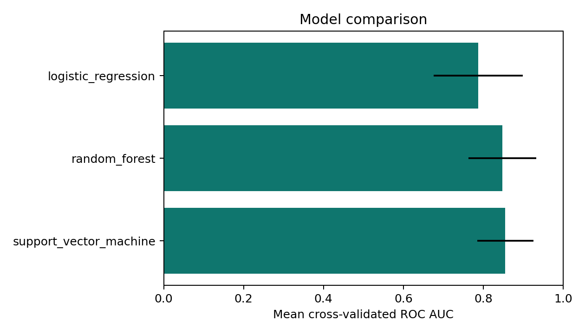
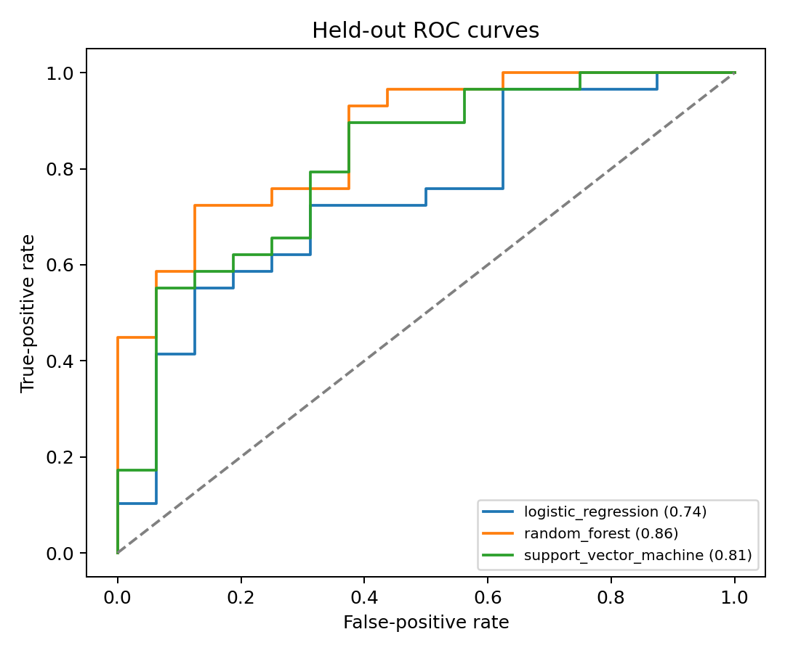

# Classifying glioma IDH status from RNA expression

IDH mutation status is one of the key molecular distinctions in glioma. I built a Python workflow to explore whether RNA-expression measurements could separate IDH-mutant and IDH-wild-type samples.

The repository includes a reproducible **synthetic-data demonstration** of the modeling pipeline. Its example scores and figures show how the code behaves, not how accurately it performs on real glioma patients.



## Approach

The workflow validates expression and label tables, joins samples by ID, and creates a stratified train/test split. Inside each training fold, it imputes missing values, removes constant features, selects genes, and scales the data. It compares logistic regression, random forest, and an RBF support vector machine using cross-validation.

The selected model is then evaluated on held-out samples. The output includes ROC and precision–recall curves, predictions, permutation importance, and a Markdown report.



## Try it

```bash
git clone https://github.com/palrabheru/glioma-idh-classifier.git
cd glioma-idh-classifier
python -m venv .venv
# Activate .venv for your operating system
python -m pip install -r requirements.txt
python analyze.py --demo --output-dir results/demo
python -m pytest -q
```

To analyze a real cohort, provide sample-by-gene expression and corresponding IDH labels using the arguments in `python analyze.py --help`. Useful starting points are [the full analysis notebook](notebooks/01_complete_analysis.ipynb), [the modeling code](src/), and [the example outputs](examples/synthetic_demo/).

## Why the distinction matters

Expression patterns can be associated with IDH status without replacing molecular testing. Real-world evaluation needs verified labels, patient-level separation, careful handling of molecular subtype and batch effects, and independent test cohorts. I built this as a flexible research workflow that can support that next stage.

**Author:** [Pal Rabheru](https://github.com/palrabheru)
